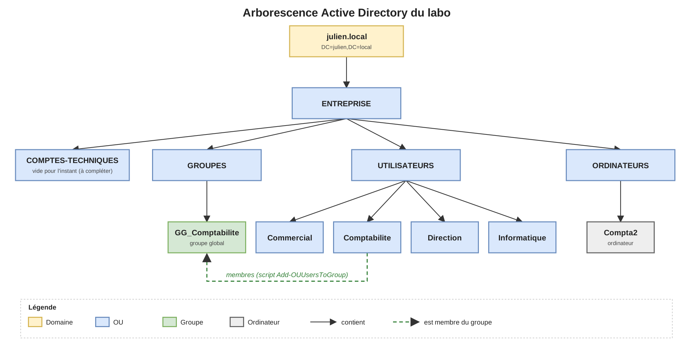

# AD-Lab

Labo personnel Active Directory pour pratiquer l'administration d'un domaine AD DS et automatiser les tâches courantes en PowerShell.

## Environnement

- Domaine : `julien.local`
- Contrôleur de domaine : Windows Server 2022 sur hyperviseur : VirtualBox
- Poste client : Windows 11, joint au domaine

## Ce qui est en place

- Arborescence d'OU organisée par type d'objet (utilisateurs par service, groupes, ordinateurs)
- Création d'utilisateurs en masse à partir d'un CSV
- Ajout en masse des utilisateurs d'une OU à un groupe de sécurité
- GPO de fond d'écran
- Dossier partagé avec permissions SMB et NTFS
- Rôle DNS sur le contrôleur de domaine, avec un redirecteur vers <8.8.8.8> pour l'accès à internet des VM

## Architecture



Les utilisateurs sont rangés dans une OU par service. Les groupes `GG_<Service>` sont dans une OU dédiée, sans accents dans les noms. L'OU `COMPTES-TECHNIQUES` est prévue pour les comptes de service et d'administration (vide pour l'instant).

## Scripts

| Script | Rôle |
|---|---|
| [`New-ADUsersFromCsv.ps1`](scripts/New-ADUsersFromCsv.ps1) | Crée les comptes depuis un CSV (`Prenom;Nom;Service;Login`). Le login devient le SamAccountName et le préfixe de l'UPN. |
| [`Add-OUUsersToGroup.ps1`](scripts/Add-OUUsersToGroup.ps1) | Ajoute tous les utilisateurs d'une OU à un groupe GG. |

Points communs : mode `-Simulation` (aucune modification dans l'AD), journal dans `C:\AD-Lab\Logs`, compteurs et code de sortie, vérifications avant traitement. Les deux scripts peuvent être relancés sans risque : les comptes ou membres déjà présents sont ignorés.

```powershell
.\scripts\New-ADUsersFromCsv.ps1 -CheminCSV .\data\utilisateurs-exemple.csv -Simulation
.\scripts\Add-OUUsersToGroup.ps1 -NomOU "Comptabilite" -NomGroupeGG "GG_Comptabilite" -Simulation
```

L'aide de chaque script est disponible avec `Get-Help .\scripts\<script>.ps1 -Full`. Les données du dépôt sont fictives.

## Ce que j'ai appris

Ce labo m'a appris les bases de l'architecture d'AD DS, avant d'approfondir lors de ma formation à venir.
Les scripts m'ont permis d'appréhender Powershell, dont l'ergonomie et la manipulation d'objet .Net m'ont agréablement surpris.

- **Structure d'un annuaire** : lecture et construction de DN, différence entre CN, SamAccountName et UPN, rôle des OU (GPO, délégation) face aux groupes (droits d'accès).
- **PowerShell** : manipulation d'objets, `-Identity` pour cibler un objet et `-Filter` pour chercher, erreurs terminantes et `try/catch` avec `-ErrorAction Stop`.
- **Scripts fiables** : mode simulation, journalisation, validation des données en entrée, code de sortie, scripts relançables sans effet de bord.
- **Services de base** : résolution DNS interne et redirecteur vers l'extérieur, permissions de partage (SMB) et NTFS.

Ce labo est une base : je compte l'approfondir pendant ma formation (modèle AGDLP, GPO supplémentaires).

## Prochaines étapes

- Modèle AGDLP (groupes globaux → groupes de domaine local → permissions)
- GPO supplémentaires (politique de mot de passe, lecteurs réseau)

## Structure du dépôt

```
AD-Lab/
├── README.md
├── scripts/   scripts PowerShell
├── data/      CSV d'exemple (fictif)
└── docs/
    └── images/   schéma (.drawio + .png)
```
